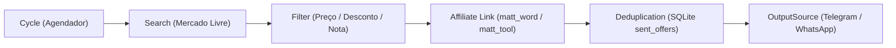

# Gwibot 🚀
### Deal Intelligence, Scraping de Alta Performance & Hub de Automação de Afiliados

[](https://www.python.org/)
[](https://fastapi.tiangolo.com/)
[](https://playwright.dev/)
[](https://www.sqlite.org/)
[](https://linear.app)
[](tests/)

O **Gwibot** é um hub completo para extração inteligente de produtos no Mercado Livre, conversão oficial de links de afiliados (`matt_word` / `matt_tool` e Linkbuilder) e distribuição automatizada e deduplicada para canais de transmissão (Telegram ativo + WhatsApp preparado) através de **Ciclos Recorrentes**.

A interface web local adota o **Linear Design System** (Dark-first de alto contraste, tipografia `Inter` + `JetBrains Mono`, atalhos de teclado rápidos e layout fixo SPA).

---

## ⚡ Principais Recursos

- 🔍 **Scraping Robusto com Playwright**: Navegação automatizada no Mercado Livre com extração confiável de preços, descontos, avaliações, vendedores e imagens, tolerante a mudanças de DOM.
- 🔗 **Conversão Oficial de Afiliados**: Suporte à conversão via parâmetros oficiais (`matt_word` / `matt_tool`) e API autenticada de Linkbuilder quando a sessão estiver conectada.
- ⏱️ **Ciclos Automatizados & Agendador Inteligente**:
  - Busca periódica por nichos/palavras-chave (suporte a rotação de múltiplas palavras-chave).
  - Intervalos configuráveis (a partir de 1 minuto).
  - Filtros finos: preço mínimo/máximo, desconto mínimo, avaliação mínima e obrigatoriedade de link de afiliado.
  - Limite de ofertas por execução e cadência configurável entre envios (`product_delay_seconds`).
  - Proteção contra concorrência e recuperação automática de ciclos ativos ao reiniciar.
- 🎯 **Deduplicação Persistente**: Histórico de produtos já enviados (`sent_offers`) gravado em SQLite com WAL ativado, impedindo spam ou reenvios indesejados.
- 📢 **Distribuição Multicanal**:
  - **Telegram Bot API**: Envio de cards visuais via `sendPhoto` com botões interativos inline e fallback automático para mensagens de texto (`sendMessage`). Suporte a templates customizáveis por plataforma.
  - **WhatsApp**: Módulo e arquitetura desacoplada prontos para conexão.
- 🖥️ **Interface Inspirada no Linear**:
  - Quatro visões integradas: **Busca Manual**, **Automação & Ciclos**, **Configurações & Afiliados** e **Histórico de Execuções**.
  - Atalhos rápidos: `/` para focar na busca, `Ctrl + K` para comando rápido, paginação rápida e visualizador JSON interativo.

---

## 📐 Arquitetura do Projeto

```text
Gwibot/
├── app/
│   ├── __init__.py             # Versão do pacote (2.0.0)
│   ├── config.py               # Configurações centralizadas (URLs, SQLite, timeouts)
│   ├── logger.py               # Logs estruturados em console e arquivo rotativo (logs/scraper.log)
│   ├── models.py               # Schemas Pydantic v2 (Produtos, Afiliados, Destinos, Ciclos e Templates)
│   ├── parser.py               # Normalização e extração de dados do Mercado Livre (MLB)
│   ├── scraper.py              # Automação Playwright, paginação e enriquecimento de links
│   ├── session_manager.py      # Login manual interativo (headed Chromium) e sessão persistente
│   ├── storage.py              # Persistência SQLite (WAL, sent_offers, templates, ciclos, logs)
│   ├── affiliates/             # AffiliateProvider ABC (Mercado Livre oficial + stubs futuros)
│   ├── cycles/                 # CycleScheduler (Agendador com métricas e concorrência controlada)
│   ├── outputs/                # OutputSource ABC (Telegram Bot API ativo + WhatsApp preparado)
│   ├── sources/                # SearchSource ABC (Mercado Livre ativo + Shopee/Amazon futuros)
│   └── main.py                 # Servidor FastAPI e rotas REST completas
├── static/
│   ├── index.html              # Interface Web SPA Linear Design System
│   ├── styles.css              # Variáveis CSS, componentes escuros e responsividade
│   └── app.js                  # Lógica de interface, atalhos de teclado e chamadas REST
├── tests/
│   └── test_app.py             # Suíte de testes automatizados (13 testes de ponta a ponta)
├── .env.example                # Exemplo de variáveis de ambiente
├── .gitignore                  # Regras de exclusão para Git
├── requirements.txt            # Dependências Python
├── run.bat                     # Script de inicialização para Windows (CMD)
└── start.ps1                   # Script de inicialização para Windows (PowerShell)
```

---

## 🔄 Fluxo de Processamento de Ciclos



---

## 🚀 Instalação e Execução

### Pré-requisitos
- **Python 3.12+** instalado.
- Conexão com a internet para instalação dos pacotes e download inicial do navegador Chromium pelo Playwright.

### 1. Clonar o Repositório
```bash
git clone https://github.com/seu-usuario/gwibot.git
cd gwibot
```

### 2. Configuração do Ambiente Virtual e Dependências

#### No Windows (usando script automático):
Você pode simplesmente executar o arquivo `run.bat`:
```cmd
run.bat
```
*O script criará o ambiente virtual em `.venv`, instalará os requisitos e os navegadores do Playwright automaticamente.*

#### Ou manualmente via Terminal / PowerShell:
```powershell
# Criação do ambiente virtual
python -m venv .venv

# Ativação do ambiente virtual
# No Windows PowerShell:
.\.venv\Scripts\Activate.ps1
# No Linux / macOS:
# source .venv/bin/activate

# Instalação das dependências
pip install -r requirements.txt

# Instalação dos navegadores do Playwright
playwright install chromium
```

### 3. Variáveis de Ambiente (Opcional)
Copie o arquivo de exemplo caso deseje customizar portas ou timeouts:
```bash
cp .env.example .env
```

### 4. Iniciar a Aplicação
```bash
uvicorn app.main:app --host 127.0.0.1 --port 8000 --reload
```
Acesse o painel web no seu navegador: **[http://127.0.0.1:8000](http://127.0.0.1:8000)**.
Documentação interativa da API (Swagger UI): **[http://127.0.0.1:8000/docs](http://127.0.0.1:8000/docs)**.

---

## ⚙️ Configuração dos Canais e Afiliados

1. **Afiliados Mercado Livre**:
   - Acesse a aba **Configurações & Afiliados** na interface web.
   - Preencha seus identificadores `matt_tool` e `matt_word` fornecidos pelo programa oficial de afiliados.
   - Opcionalmente, utilize o botão de **Login Interativo** para manter sua sessão do Mercado Livre salva em `.session/` e liberar o Linkbuilder avançado.

2. **Canal do Telegram**:
   - Crie um bot através do [@BotFather](https://t.me/BotFather) e obtenha o `Bot Token`.
   - Adicione o bot como administrador do seu canal ou grupo.
   - Obtenha o `Chat ID` do canal (ex: `@meucanaldeofertas` ou `-1001234567890`).
   - Cadastre o destino na aba **Configurações & Afiliados** e utilize o botão de **Testar Envio**.

3. **Criação de Ciclos**:
   - Vá para a aba **Automação & Ciclos**.
   - Defina o nome do ciclo, termos de busca (ex: `Monitor Gamer, Cadeira Ergonômica`), intervalo (em minutos), limites de preço, desconto mínimo e selecione o canal de destino.
   - Clique em **Salvar Ciclo** e ative o agendamento.

---

## 🧪 Suíte de Testes Automatizados

O Gwibot possui cobertura rigorosa de testes de ponta a ponta com `pytest`, cobrindo extração Playwright, parsing de DOM com valores nulos, geração e validação de afiliados, concorrência de ciclos e fallback do Telegram:

```powershell
.\.venv\Scripts\python.exe -m pytest -v
```

Resultado esperado:
```text
tests/test_app.py::test_health_and_sources_endpoints PASSED
tests/test_app.py::test_index_web_ui PASSED
tests/test_app.py::test_search_validation_errors PASSED
tests/test_app.py::test_parser_complete_and_null_fields PASSED
tests/test_app.py::test_playwright_dom_extraction_in_isolated_chromium PASSED
tests/test_app.py::test_affiliate_link_generation_and_failure_detection PASSED
tests/test_app.py::test_full_pipeline_mercadolivre_to_affiliate_to_telegram PASSED
tests/test_app.py::test_session_persistence_logout_and_expiration_detection PASSED
tests/test_app.py::test_cycle_concurrency_and_telegram_retry_fallback PASSED
tests/test_app.py::test_multi_keywords_cycle_edit_and_product_delay_validation PASSED
tests/test_app.py::test_affiliate_sources_destination_editing_and_platform_templates PASSED
tests/test_app.py::test_idempotent_creation_and_pagination_unblock PASSED
tests/test_app.py::test_performance_optimizations_stage_metrics_and_1min_scheduler PASSED

======================= 13 passed in ~20s =======================
```

---

## 🛡️ Segurança e Boas Práticas

- **Segurança de Credenciais**: Os diretórios `.session/`, `data/`, `logs/` e arquivos `.env` contêm informações sensíveis e estão devidamente ignorados no `.gitignore`. **Nunca faça commit de cookies de autenticação ou tokens de bots.**
- **Concorrência e Locks**: As rotas de disparo de ciclos utilizam controle contra duplicação concorrente para evitar flood de requisições.

---

## 📄 Licença

Distribuído sob a licença MIT. Consulte `LICENSE` para mais detalhes.
